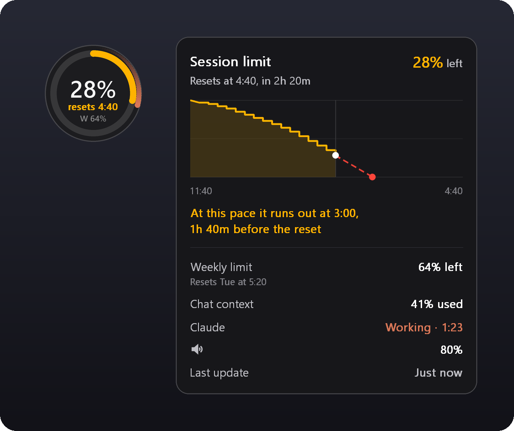
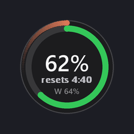
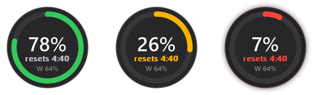
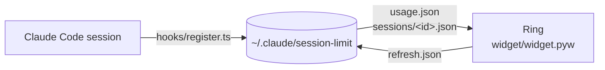
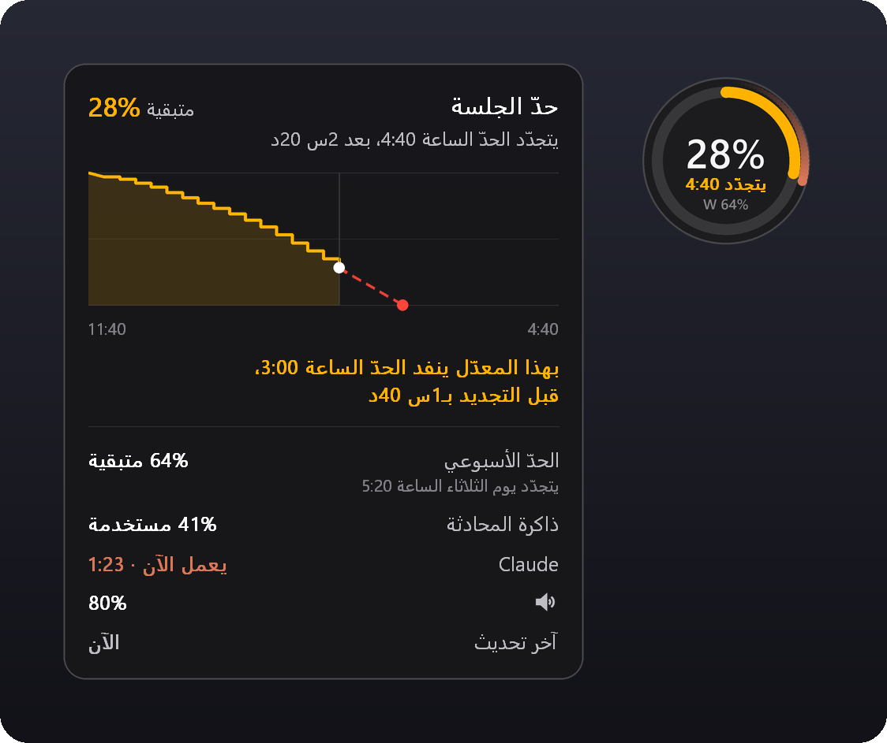

<div align="center">

# Session Limit

**A floating ring on your Windows desktop that shows how much of Claude's 5-hour limit you have left.**

It sounds a siren that rises as the limit runs out, spins while Claude works, and chimes when a long reply is done.


[](LICENSE)

[English](#features) · [العربية](#بالعربي)

<br>



</div>

---

## Features

- **Always-on-top ring.** Shows the percent of the 5-hour session limit left. It turns green, then amber at 30%, then red at 10%.
- **Rising siren.** As the limit runs out, a continuous tone climbs in pitch. Double-click the ring to mute it.
- **Live activity.** The ring spins while Claude is working and chimes when a reply that took more than 15 seconds finishes.
- **Hover card.** Hover the ring to see:
  - a usage graph for the current window
  - a forecast of when you'll run out at your current pace, or how much will be left at reset
  - the weekly limit and when it resets
  - how full the current chat's context is
- **Tray icon.** Sits by the clock with the same reading. Click it to show or hide the ring.
- **Refresh on demand.** Picks up usage from claude.ai too, not just Claude Code.
- **Codex support.** If you use OpenAI Codex, a second teal ring tracks its limits. It can also follow Codex on your SSH servers (off by default).
- **Arabic and English.** Right-to-left layout in Arabic. Switch from the right-click menu.

<p align="center">
  
  &nbsp;&nbsp;
  
</p>
<p align="center"><sub>Spinning while Claude works · green, amber at 30%, red with a pulsing glow at 10%</sub></p>

## Requirements

| | |
|---|---|
| **OS** | Windows 10 or 11. On macOS and Linux the plugin still records usage, but there's no ring. |
| **Claude Code** | The desktop app (Code tab) or the terminal CLI |
| **Python** | Python 3 with `pythonw.exe` or `pyw.exe` on your PATH (tested with 3.12) |
| **Python packages** | `numpy`, `pillow` |

Install the Python packages once:

```bash
pip install numpy pillow
```

## Installation

### From claude.ai

1. Open **Customize** → **Plugins** → **Add** → **Add marketplace**
2. Enter `OdayM-Dev/session-limit`
3. Install **session-limit**

### From the terminal

```bash
claude plugin marketplace add OdayM-Dev/session-limit
claude plugin install session-limit@odaym-plugins
```

Start a new Claude Code session. The ring appears on its own.

If Python or a package is missing, a message in Claude says what to install.

## Usage

### The ring

| Action | What it does |
|---|---|
| **Hover** | Opens the card with the graph, forecast, weekly limit and context |
| **Drag** | Moves the ring anywhere on screen |
| **Double-click** | Mutes or unmutes the siren |
| **Scroll** | Turns the siren's volume up or down |
| **Middle-click** | Refreshes the reading now |
| **Right-click** | Opens the menu |

### Tray icon

| Action | What it does |
|---|---|
| **Hover** | Opens the card |
| **Click** | Shows or hides the ring |
| **Right-click** | Opens the menu |

### Menu

- **Refresh now:** fetches a fresh reading, claude.ai use included
- **Mute the siren**, **Volume**, **Chime when Claude finishes**
- **Preview:** hear the siren at different levels, or the chime
- **Show the ring:** keep only the tray icon if you prefer
- **Start with Windows:** launches the ring when you sign in, for your user only
- **Follow Codex on servers:** for Codex users, keeps an SSH session open to each server the Codex app lists
- **Language:** العربية or English

## How it works



1. **The hook module** (`hooks/register.ts`) runs inside every Claude Code session. It records:
   - the rate-limit readings and the 5-hour window's history, in `usage.json`
   - each session's state (working or not, context fill), in `sessions/<id>.json`

   It also starts the ring if it isn't already running.
2. **The ring** (`widget/widget.pyw`) is a standalone Python app. It reads those files and does all the drawing, sound and forecasting on its own. Only one copy runs at a time.
3. **Refresh now** drops a `refresh.json` file. One open session answers it with the smallest possible model call (Haiku, 1 token), because every response carries the latest limits.

## Privacy

- **Everything stays on your computer**, in `%USERPROFILE%\.claude\session-limit`.
- **Nothing is sent anywhere** except the 1-token Haiku call when you press **Refresh now**. That call goes through your own Claude session.
- **Codex logs are read locally.** The plugin reads them from `~/.codex/sessions`. It connects to your SSH servers only if you turn on **Follow Codex on servers**.

## Uninstall

1. Right-click the ring, untick **Start with Windows**, then choose **Quit**.
2. Remove the plugin:
   ```bash
   claude plugin uninstall session-limit@odaym-plugins
   ```
3. Optionally, delete the folder `%USERPROFILE%\.claude\session-limit` to remove its saved readings.

## Project layout

```
.claude-plugin/
  plugin.json        plugin manifest
  marketplace.json   marketplace manifest (this repo is its own marketplace)
hooks/
  hooks.json         registers the hook module
  register.ts        feeds the ring from each Claude Code session
widget/
  widget.pyw         the ring, its card, tray icon and sounds
  make_icon.py       regenerates ring.ico
  ring.ico
tests/
  session-limit.test.ts
docs/
  render_docs.py     redraws the README images with the widget's own code
```

## License

[MIT](LICENSE) © OdayM-Dev

---

<div dir="rtl">

## بالعربي

**دائرة عائمة على سطح مكتب ويندوز توريك كم باقي من حدّ Claude للخمس ساعات.**

<p align="center"></p>

### المميزات

- **دائرة فوق كل النوافذ.** تعرض نسبة الحدّ المتبقية. لونها أخضر، ثم برتقالي عند 30%، ثم أحمر عند 10%.
- **صوت إنذار.** يعلى كل ما قرب الحدّ يخلص. دبل كلك على الدائرة يكتمه.
- **تعرف إن Claude شغّال.** الدائرة تلف وهو يشتغل، وتنبّهك بصوت إذا خلص ردّ أخذ أكثر من 15 ثانية.
- **بطاقة تفاصيل لما تمرّر عليها:**
  - رسم بياني للاستهلاك
  - توقّع متى يخلص الحدّ بنفس سرعة استخدامك
  - الحدّ الأسبوعي
  - كم تعبّت المحادثة الحالية من ذاكرتها
- **أيقونة جنب الساعة** فيها نفس القراءة.
- **تحديث فوري.** يحسب استخدامك في claude.ai بعد، مو بس Claude Code.
- **يدعم Codex** بدائرة ثانية لونها أخضر مزرق.
- **عربي وإنجليزي.** العربي هو الافتراضي.

### المتطلبات

- ويندوز 10 أو 11
- Claude Code (تبويب Code في التطبيق، أو الطرفية)
- بايثون 3، مع تنصيب `numpy` و `pillow`:

<div dir="ltr">

```bash
pip install numpy pillow
```

</div>

### التنصيب

**من claude.ai:** افتح Customize ← Plugins ← Add marketplace، واكتب `OdayM-Dev/session-limit`، ونصّب **session-limit**.

**من الطرفية:**

<div dir="ltr">

```bash
claude plugin marketplace add OdayM-Dev/session-limit
claude plugin install session-limit@odaym-plugins
```

</div>

بعدها افتح جلسة جديدة، والدائرة تطلع بروحها.

### طريقة الاستخدام

| الحركة | وش تسوي |
|---|---|
| **تمرير الماوس** | تفتح بطاقة التفاصيل |
| **سحب** | تحرّك الدائرة لأي مكان |
| **دبل كلك** | تكتم صوت الإنذار أو ترجّعه |
| **عجلة الماوس** | ترفع الصوت أو تنزّله |
| **ضغط العجلة** | تحديث فوري |
| **كلك يمين** | القائمة: الصوت، التشغيل مع ويندوز، اللغة، وغيرها |

### الخصوصية

كل البيانات تبقى على جهازك في `%USERPROFILE%\.claude\session-limit`. ما يطلع منها شي إلا لما تضغط **تحديث الآن**، وقتها تروح طلبة صغيرة جداً لـ Haiku (توكن واحد) من جلستك.

### الرخصة

[MIT](LICENSE): تقدر تستخدمها وتعدّل عليها وتنشرها ببلاش، بشرط يبقى نص الرخصة واسم صاحبها.

</div>
